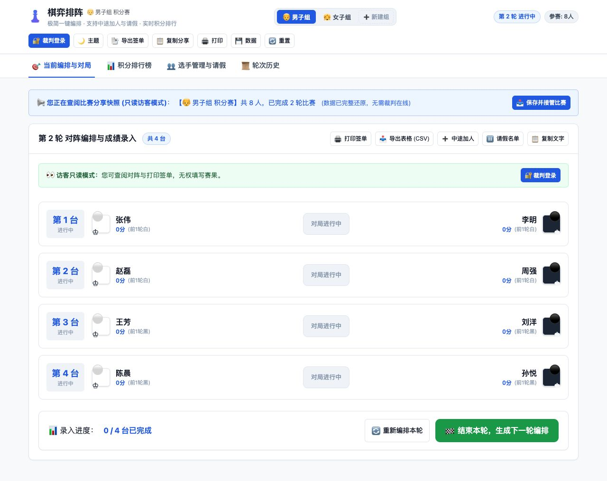

# 棋弈排阵整体评审与整改方案

评审日期：2026-10-13（北京时间）。基线：`e54fa7c`。开始评审时工作区干净。本轮未修改业务代码，新增评审文档、复现脚本和证据。

## 结论

项目有清楚的俱乐部使用场景：粘贴名单、配对、录分、排行榜、请假、分享和签单。纯静态实现无需构建，编排、存储和控制器已初步分离，适合继续发展为单裁判、小型赛事工具。

目前建议定位为“俱乐部简化瑞士制工具，试用阶段”。尚不满足可靠的赛场交付条件，尤其存在覆盖已有赛事、导入失败仍破坏原数据、快照接管无法正确退出快照、颜色规则失效和签单打印样式冲突。代码中的 Dutch-Swiss Heuristic 描述不能证明实现了完整 FIDE Dutch 系统。

优先级定义：P1 为应在赛场使用前解决的正确性、数据安全或核心功能问题；P2 为应进入下一迭代的功能与工程问题。未发现足以判定为普遍阻断所有使用的 P0。

## 已完成的验证及边界

| 项目 | 结果 | 证据范围 |
| --- | --- | --- |
| 全部业务 JS、HTML、CSS、启动和部署配置 | 已审阅 | 源码 |
| `npm test` | 失败，脚本为占位命令 | Node v24.6.0 |
| `node test_simulation.js` | 正常退出 | 一个 8 人→9 人、3 轮样例；非全面正确性证明 |
| 新增 `reproduce.cjs` | 11 项问题探针复现成功 | 引擎/存储实际模块；控制器在 VM 中使用 DOM 存根 |
| 浏览器 8 人开赛、登录、第一轮录分、第二轮配对 | 路径走通 | 本地 Codex 内置浏览器 |
| 浏览器历史轮次深链接 | 复现失败 | 指定第一轮历史后，回到第二轮当前编排 |
| 浏览器快照链接打开 | 能还原赛事，但对阵轮前分错误 | 第二轮原为 1 分的棋手显示 0 分 |
| Safari、微信内置浏览器、手机、实际 PDF/纸张、线上部署 | 未验证 | 不能据本轮结论签收这些环境 |

复现：在项目根目录运行 `node reports/review-2026-10-13/reproduce.cjs`。详细输出见 `evidence.json`。脚本以断言确认当前问题仍可复现，退出成功表示复现成功，**不代表项目验收通过**。脚本只在内存中暴露控制器函数，未给应用加入测试入口。

## 具体问题

### R01 · P1：颜色限制只是排序罚分，重复交手会自动放行

位置：`js/swiss.js:321`、`:471`、`:492`、`:543`。

颜色冲突只影响候选排序，不会拒绝非法组合；回溯找到第一个完整组合后即返回，也不检查整轮是否满足约束。固定 8 人样例中，种子 10 的第 5 轮使 P6 达到 4 白/1 黑，颜色差为 3；种子 11 的第 5 轮让 P6 连续三次执黑。两个样例均存在不重复且满足颜色约束的整轮替代配对，算法均未发出警告。

2 人第二轮会自动重复交手并返回提示，与 README“绝不重复交手”不一致。奇数池中所有人都轮空过时，还会再次给予轮空。

方案：确定俱乐部规则，将禁止重复、颜色限制、轮空资格变为显式约束；严格模式无解时停止生成并解释冲突。若保留娱乐赛放宽模式，应由裁判明确选择，并记录放宽原因及具体台次。建立独立的整轮验证器；不要以更高罚分代替规则。

FIDE 当前基本规则要求提前声明轮数、禁止重复对弈、限制轮空资格，并规定颜色约束及各系统可能的例外。是否适用例外应由选定系统决定，不能由当前算法默默放宽。[FIDE C.04.1，2026-02-01 起生效](https://handbook.fide.com/chapter/C0401202507)

### R02 · P1：快照并非无损，签单中的轮前分会变成 0

位置：`js/storage.js:253`、`:353`。

压缩不保存对阵中的 `whiteScore`、`blackScore`、`playerScore`；解压全部设为 0。Node 往返样例由 `[3,2]` 变为 `[0,0]`，浏览器第二轮也复现。排行榜总分可由历史结果重算，当前证据未发现这一路径的总分丢失；错误集中在对阵显示、CSV 和签单的轮前分。此外 `warning` 也未保留，分享后可能丢失重复对局提示。

方案：保留赛事规则和异常标记，并按该轮之前的历史重建轮前分，或直接保存这些值。对压缩/解压做语义等价比较，覆盖轮空、请假、迟到加入、放宽规则。加快照生成时间、版本和“截至某时”文案；快照不会跟随原裁判后续修改自动更新。

### R03 · P2：深链接会被重复初始化覆盖

位置：`js/app.js:30`、`:541`、`:634`。

无快照分支已加载组别并应用 `round/tab`，却返回 `false`，导致 `init` 再次执行 `switchGroup`；后者恢复本地 `activeTab` 并把历史轮次重置为最后一轮。浏览器访问 `?group=men&round=1&tab=history`，实际回到 `round=2&tab=pairing`。

方案：初始化只加载一次；先解析并校验 URL，再载入领域数据，最后应用视图路由，结束后才同步 URL。限制合法 tab、组别和轮次。加入刷新、历史页和 `sheet=1` 的浏览器测试。

### R04 · P1：快照接管和组别切换没有隔离快照状态

位置：`js/app.js:470`、`:640`、`:1523`。

接管先保存完整 `state`，后清除内存中的 `isSnapshot`，导致本地持久化仍为 `true`；URL 的 `#d=` 也未删除。刷新会重新加载原分享快照，管理中的新结果可能在界面上被旧快照覆盖。接管不解锁管理权限，也不重新渲染权限界面。快照中切到其他组别后 `isSnapshot` 仍为真，组别、横幅、URL 和本地保存语义不一致。自定义组快照接管也未登记到组别列表。

方案：把赛事领域数据、登录状态、视图状态、快照来源分离。接管前检测本地同组比赛，提供另存副本或明确覆盖及自动备份；成功保存后清除 hash、快照标记并登记组别，再刷新 UI。普通查看快照期间禁止写入本地比赛。

### R05 · P1：JSON 导入缺少完整校验，失败仍可覆盖原数据

位置：`js/app.js:1690`。

只检查 `players` 是数组，就把外部对象合并进全部 `state` 并保存，然后才渲染。探针导入 `rounds: "bad-data"`：原存储已被坏数据覆盖，之后才弹出“导入失败”；输入还可带入 `isAdmin`、`isSnapshot` 等运行状态。导出 JSON 又直接导出完整 `state`，把这些非赛事字段带进备份。

方案：版本化 schema、字段白名单、唯一数字 ID、合法结果枚举、对局引用、台次和轮次一致性、索引范围校验；在临时对象上完成解析和统计计算，全部通过后一次提交。失败保留原比赛，覆盖前自动备份。权限和视图状态不进入赛事文件。

### R06 · P1：名单模板会覆盖另一个组的比赛；删组后数据会被写回

位置：`js/app.js:702`、`:722`、`:428`、`:470`。

在空组的准备页载入女子模板，会直接把 `state.groupId` 改成 `women`，没有加载或检查该组现存比赛。随后开赛可覆盖已有女子赛事；VM 样例的 4 轮赛事被替换成 1 轮，且没有覆盖确认。

删除自定义组后调用默认 `switchGroup(next)`，切换逻辑又保存已删除的旧组，导致组列表已删除而比赛数据重新存在；旧链接仍可加载该组数据。

方案：名单模板只填写当前组，不改变比赛身份。删除后切组跳过保存旧组；更通用地，将切组保存、创建、覆盖、删除做成清晰的事务，并用固定 `tournamentId` 避免把“组别”当作永久赛事身份。

### R07 · P1：外部数据进入 HTML 时转义不完整

位置：`js/app.js:819`、`:1233`，以及结果、board/round/score 等模板插值。

请假名单直接插入 `${p.name}`；排行榜对手姓名直接进入 HTML 属性。Node 探针确认姓名中的 `<b>review-marker</b>` 原样进入请假名单 HTML。结合无需严格校验的快照和 JSON 入口，存在 DOM 注入/XSS 路径。当前未在浏览器执行恶意脚本；风险来自确定的未转义插值与不可信入口。

方案：优先 DOM 节点加 `textContent`，属性使用安全赋值；所有外部字段校验并限制长度；姓名、标题、结果等统一处理。可增加 CSP 作为补充，不能替代正确转义。

### R08 · P1：签单打印 CSS 隐藏了签单的祖先容器

位置：`css/app.css:1038`、`js/app.js:1871`、`index.html` 的 `modalPrintSheet`。

打印媒体中 `.modal-backdrop:not(.printing-active)` 被设为 `display:none!important`；签单位于该模态框内。打印处理只加 `body.printing-sheet-mode`，从未给模态框加 `printing-active`。子元素设为可见无法恢复被 `display:none` 隐藏的祖先，签单可能输出空白。该结论为源码/CSS 路径核查，本轮没有实际打印 PDF。

方案：将专用打印容器置于不被隐藏的顶层，或正确切换祖先打印状态；用 `afterprint` 清理，不依赖 500ms 定时器。明确 A4 页边距、分页、重复表头及黑白效果，实际导出 PDF 检查 7/20/100 人和长姓名。

### R09 · P1：比赛生命周期不完整，历史改分与下轮配对失去一致性

位置：`js/app.js:15`、`:1104`、`:1157`、`:1456`。

定义了 `finished`，却没有正常结束赛事的操作，也没有预设轮数。强制结束当前轮会保留 `null` 结果，历史仍展示“进行中”；所谓双方 0 分没有独立赛果类型。历史比分直接修改后，已生成后续配对与轮前分保留旧依据，没有标记失效、锁定或审计记录。

方案：增加计划轮数和赛事结束；轮次区分 draft/paired/in_progress/completed。区分待录入、双方弃权、单方弃权、轮空、请假和尚未加入。后续轮已公布时，历史纠错需记录原因，保留既有对阵并提示依据已变；后续轮仍为草稿时，可确认撤销并重新编排。不能静默改动已开始的对阵。

请假状态目前也直接修改 `state`，关闭弹窗并不撤销；“本轮请假”的标签不会自动修改已生成的本轮对阵，实际影响的是下一次生成。需清楚区分本轮排阵与后续参赛状态。

### R10 · P2：破同分只实现基础公式，未明确未赛轮次规则

位置：`js/swiss.js:108`、`:156`、`:259`、`:279`。

轮空得 1 分并计入胜局，但无对手的轮次对 BH/SB 贡献为 0；迟到选手的入场前轮次统一记“请假/未参赛”。目前是俱乐部简化规则，不能据此认定正式赛事名次正确。进行中的配对也会进入对手分统计，应明确显示临时排名口径。

方案：开赛前固化规则版本与破同分顺序，并在界面/导出中说明。若继续采用简化公式，准确标注；若目标为正式瑞士赛，补全未赛轮次和弃权处理，并用人工核算的金标准数据验证。FIDE 当前 BH/SB 定义明确关联未赛轮次处理。[FIDE 破同分规则，2026-03-01 起生效](https://handbook.fide.com/chapter/TieBreakRegulations032026)

### R11 · P1：存储失败没有进入操作成功判定

位置：`js/storage.js:118`、`js/app.js:1523`、`:640`。

底层 `saveTournament` 失败返回 `false`，调用方忽略返回值并继续报成功。组别保存也只记录 console 错误。浏览器存储满、受限或不可用时，用户可能以为赛果已持久化。跨标签页无版本检查，旧标签切组时也可能把旧状态写回。

方案：持久化成功后才显示“已保存”；失败时持续标记未保存并给 JSON 备份入口。加入保存版本、更新时间和 `storage` 事件/冲突检测，避免同源多标签页静默覆盖。本轮为源码结论，尚未注入浏览器配额失败或双标签冲突。

### R12 · P2：CSV、权限文案和测试/发布边界需整理

位置：`js/storage.js:174`、`js/app.js:7`、`:428`、`:1718`、`index.html:557`、`package.json:7`、`test_simulation.js`。

- CSV 姓名无引号转义，标题虽有引号却不转义内含引号；导入/加人中的逗号、换行会破坏列结构。`= + - @` 开头文本也没有电子表格公式处理。
- 密码写在前端源码及输入框 placeholder，权限标记保存在 localStorage；这是本地防误触机制，无法构成可信身份认证。访客仍能开赛、导入、重置和建组，控制范围不一致。它不会让访客直接修改其他设备的存储，但会影响同一浏览器原比赛。
- 初始名单自动合并同名并移除等级分；需提示导入预览和保留等级分排序，避免两位同名棋手被合并或用户误以为按等级分编排。
- `npm test` 为失败占位，无 CI。现有模拟中重复对阵只打印错误但不返回失败；“验证最低分轮空”实际仅验证存在轮空，未断言最低分。积分、BH、SB、颜色等主要靠打印。
- `pages_build_output_dir = "."`，无独立发布目录。应明确允许发布的文件，避免将启动脚本、测试、评审证据等作为站点资产上传；本轮未检查线上是否已存在这些文件。
- 源码无 service worker。已加载页面和本地文件可离线运行，不足以证明托管页面在断网刷新/首次打开时可用。压缩 API 不支持或格式不兼容时，快照生成/读取也没有可见错误；`buildShareUrl` 可能退回不带数据的普通网址。

方案：统一 CSV 字段编码；把权限定位和写操作控制统一；接入真实测试与 CI；以白名单目录发布并验证线上文件哈希。保留纯前端架构，只有在明确需要在线权威数据、跨设备同步或多人协同时才引入后端认证与同步。

## 分阶段评审与整改方案

| 顺序 | 工作包 | 方法与交付 | 通过条件 |
| --- | --- | --- | --- |
| 1 | 保护赛事数据 | 修 R04/R05/R06/R07/R11；分离领域状态与 UI/身份；版本化 schema；备份/覆盖/接管事务 | 无效导入、取消操作和保存失败不破坏原数据；快照查看零写入；接管刷新继续同一份新数据；组别不互相覆盖 |
| 2 | 编排与计分 | 约定俱乐部规则；修 R01/R09/R10；独立 validator 和金标准样例；严格/放宽策略显式化 | 所有生成轮每人恰好一次；无自对局；轮空资格、重复和颜色限制符合选定规则；无解明确停止；所有积分与破同分可解释 |
| 3 | 完整用户旅程 | 修 R02/R03/R08/R12；从空浏览器开赛，完成预定轮数，结束、备份、还原、分享、接管和打印 | 对阵、榜单、签单、CSV、JSON、快照一致；所有合法深链接定位正确；赛事正常结束而非只能继续下一轮 |
| 4 | 浏览器与规模 | 桌面 Chrome/Safari、iPhone Safari、Android/微信；20/50/100 人和多轮；恶劣历史压力样例 | 核心按钮可触达、无误操作；无长时间主线程冻结；记录性能与 URL 长度，不凭常规样例推断上限；必要时 Worker/搜索预算 |
| 5 | 发布验收 | npm test 与 CI；明确发布资产；版本与变更说明；部署后普通网址检查 | 自动化检查通过；线上 HTML/JS/CSS 与批准版本一致；全新设备快照打开、备份还原和实际打印通过；所有遗留项明确 |

以上为建议实施顺序，本轮已完成初次评审与问题复现，尚未实施整改。

## 最小验收用例矩阵

| 类别 | 必测输入/操作 | 必核对项 |
| --- | --- | --- |
| 编排 | 2/3/7/8/20 人；全和、全白胜、随机固定种子；历史几乎打满 | 重复、自对局、每人一次、轮空资格、颜色、无解解释 |
| 计分 | 正常胜和负、轮空、迟到、请假、退赛、双方弃权、往轮纠错 | 人工期望 score/BH/SB/wins；规则版本和轮前分 |
| 数据 | 重复 ID、悬空引用、无效赛果、坏轮次/索引、未知版本、截断/超大文件 | 原数据不变；不接受权限/UI 字段；错误可理解 |
| 快照 | 当前/历史、奇数、请假、自定义组、旧快照、本地同组已存在 | 无损语义；时间戳；查看零写入；接管冲突；刷新保留后续录分 |
| 状态 | 多组切换、名单模板、删组、同名棋手、取消请假、结束赛事 | 无跨组覆盖、无删除后写回、名单数量准确、轮次状态完整 |
| 导出 | 中文/长姓名/引号逗号换行/公式前缀；20/100 人；历史日期 | CSV 列数与转义；A4 PDF 无空白/截断；内容与领域数据一致 |
| 故障 | localStorage 抛错、双标签并发、断网刷新、压缩 API 不兼容 | 不虚报保存/快照成功；恢复入口；明确离线边界 |

## 浏览器证据

第一轮全白胜后，第二轮张伟、李明、赵磊、周强的轮前分均为 1。打开生成的快照，卡片均显示 0 分；横幅同时把“生成 2 轮”说成“已完成 2 轮”，而实际第二轮 0/4 台完成。

